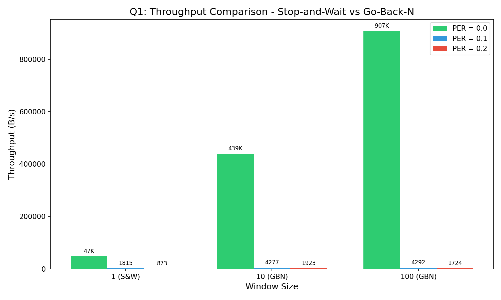
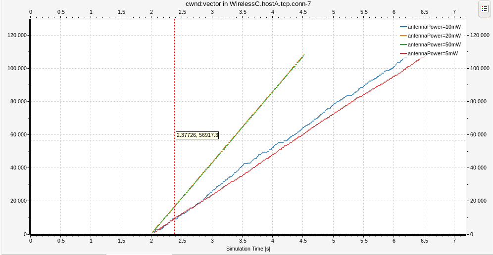
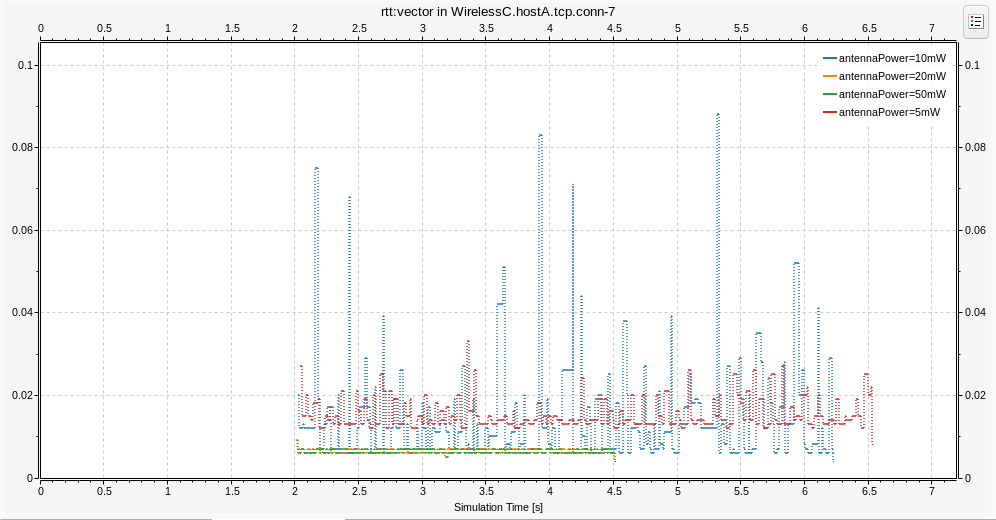

# Reliable Data Transfer & TCP over Wireless

This project looks at reliability at two levels of a network. The first part builds two reliable data transfer protocols, Stop-and-Wait and Go-Back-N, and measures how they behave as the channel gets more lossy. The second part runs TCP over a multi-hop wireless network and shows how the physical layer, through the antenna power, decides how well TCP performs.

## Q1: Stop-and-Wait & Go-Back-N

### Overview

Two reliable data transfer protocols (as described in Kurose & Ross, Section 3.4.3), implemented in OMNeT++. Both use sequence numbers, ACKs and timers to deliver a file reliably over a lossy channel.

**Stop-and-Wait** (window size 1)
- Sender transmits one segment and waits for its ACK
- No new data is sent until the ACK arrives or a timeout occurs
- On timeout, the segment is retransmitted

**Go-Back-N** (window size N > 1)
- Sender keeps a window of up to N unACKed segments
- On timeout, all segments from the first unACKed one are retransmitted
- Receiver uses cumulative ACKs

The network is a client and a server connected by lossy bidirectional links.

### Simulation Parameters

| Parameter | Value |
| --- | --- |
| Channel datarate | 10 Mbps |
| Channel delay | 10 ms |
| Max message size | 1000 B |
| File size | 200,000 B |
| Timeout | 0.2 s |
| PER values | 0.0, 0.1, 0.2 |
| Window sizes | 1 (S&W), 10, 100 (GBN) |

### Results

**Throughput (B/s)**

| Window Size | PER = 0.0 | PER = 0.1 | PER = 0.2 |
| --- | --- | --- | --- |
| 1 (Stop-and-Wait) | 47,499 | 1,815 | 873 |
| 10 (Go-Back-N) | 438,729 | 4,277 | 1,923 |
| 100 (Go-Back-N) | 907,257 | 4,292 | 1,724 |

**Completion time (s)**

| Window Size | PER = 0.0 | PER = 0.1 | PER = 0.2 |
| --- | --- | --- | --- |
| 1 (Stop-and-Wait) | 4.21 | 110.20 | 229.21 |
| 10 (Go-Back-N) | 0.46 | 46.76 | 104.01 |
| 100 (Go-Back-N) | 0.22 | 46.60 | 116.03 |

**Retransmissions and efficiency**

Efficiency = useful packets / all packets sent.

| Window | Retransmitted (PER 0.1) | Efficiency (PER 0.1) | Retransmitted (PER 0.2) | Efficiency (PER 0.2) |
| --- | --- | --- | --- | --- |
| 1 | 46 | 81% | 93 | 68% |
| 10 | 213 | 48% | 449 | 31% |
| 100 | 1,773 | 10% | 4,337 | 4% |

At PER = 0.0 there were no retransmissions and every protocol had 100% efficiency.

### Analysis

**Effect of increasing PER**
- Throughput drops by 95-99% at PER = 0.2 compared to PER = 0.0
- Transfers take 20-50x longer
- Retransmissions grow a lot, especially with larger windows
- Efficiency falls from 100% to as low as 4%

**Stop-and-Wait vs Go-Back-N**
- With no loss, Go-Back-N with N = 100 is 19x faster than Stop-and-Wait, because larger windows keep the channel full
- At PER = 0.1, N = 10 and N = 100 reach almost the same throughput (~4,300 B/s), but N = 100 needs 1,773 retransmissions (10% efficiency)
- At PER = 0.2, N = 100 is actually slower than N = 10 (1,724 vs 1,923 B/s)
- Stop-and-Wait is always the slowest but the most efficient

**Does a higher N always make sense?**

No. With no loss a larger window is better, but on a lossy channel it backfires:
- Go-Back-N retransmits the whole window on a timeout
- A larger window means more packets to resend, so more wasted bandwidth
- Many of the retransmitted packets get lost too, which causes even more retransmissions

The best window size depends on the channel. A rough guideline is N ≈ 1 / PER, so N ≈ 10 for PER = 0.1, and even smaller for PER = 0.2.

## Q2: TCP Performance in Wireless Networks

### Overview

The UDP applications of INET's wireless tutorial network (WirelessC) were replaced with a TCP client and server, and the network was tested with different antenna transmission powers.

- **hostA**: TCP client (sender)
- **hostB**: TCP server (receiver)
- **hostR1, hostR2, hostR3**: relay nodes for multi-hop routing
- AODV routing for route discovery

### Simulation Parameters

| Parameter | Value |
| --- | --- |
| Simulation time | 60 s |
| Radio medium | ApskScalarRadioMedium |
| Path loss model | TwoRayGroundReflection |
| PHY data rate | 1 Mbps |
| Carrier frequency / bandwidth | 2 GHz / 2 MHz |
| TCP algorithm | TcpReno |
| Antenna power | 5 mW, 10 mW, 20 mW, 50 mW |
| Node mobility | Static |

### Results

| Metric | 5 mW | 10 mW | 20 mW | 50 mW |
| --- | --- | --- | --- | --- |
| Bytes received | 0 | 1,106,000 | 1,676,000 | 1,676,524 |
| Throughput | 0 | ~18.4 KB/s | ~27.9 KB/s | ~27.9 KB/s |
| Delivery ratio | 0% | ~100% | ~100% | ~100% |
| Mean RTT | 15.4 ms | 14.7 ms | 6.5 ms | 6.5 ms |
| Total collisions | ~2,168 | ~2,414 | ~3 | 0 |
| Packet drops | 0 | 0 | 0 | 0 |
| Max queue length | 2 | 2 | 2 | 2 |

**TCP state variables**

- **cwnd**: grows fastest at 50 mW (~110,000 bytes) and slowest at 5 mW, where the transfer never completes. 20 mW and 50 mW behave almost the same
- **ssthresh**: stays at its initial value for every power level, so no congestion events happened
- **RTT**: lowest and most stable at 50 mW (~5-6 ms), highest with more variance at 5 mW (~15-20 ms)

- **RTTVAR**: starts high (~0.6-0.7 s) and quickly drops to near zero as TCP learns the network
- **RTO**: starts at ~2.5-3 s and settles at ~1 s for all configurations

**Network and PHY layer**
- Queue length stays between 0 and 2 packets, no overflow, so the network is not congested
- Higher antenna power gives a higher SNR (around 250-300 at 50 mW, mostly 0-100 at lower powers)

### Analysis

**Effect of antenna power**
1. **5 mW (too low)**: the signal is too weak for reliable multi-hop communication. AODV finds routes, but TCP transfers no data in 60 s, and the high collision count shows interference
2. **10 mW (marginal)**: data gets through, but ongoing collisions cut throughput by about 50% compared to higher powers
3. **20 mW and 50 mW (optimal)**: almost no collisions, the lowest RTT and the highest throughput. The difference between them is minimal, so 20 mW is enough for this network

**Key findings**
- There is a threshold between 5 mW and 10 mW below which TCP fails completely
- Higher power cuts RTT by about half (from ~15 ms to ~6.5 ms)
- Collisions depend heavily on power (~2,168 at 5 mW vs 0 at 50 mW)
- Queues and packet drops were not the limiting factor; the physical layer was

**How the metrics connect**
- Higher SNR → fewer bit errors → fewer MAC retransmissions
- Fewer collisions → lower delay → lower RTT
- Lower RTT → faster ACKs → faster cwnd growth → higher throughput

## Conclusion

**Q1**
- At low PER, Go-Back-N with large windows is much faster than Stop-and-Wait (up to 19x)
- At high PER, large windows become counterproductive because of excessive retransmissions
- Stop-and-Wait has the highest efficiency but the lowest throughput
- The best window size depends on the channel, bigger is not always better

**Q2**
- Antenna power directly affects SNR and collision rates
- TCP congestion control reacts to the conditions below it
- A minimum power is needed for TCP to work at all (between 5 and 10 mW)
- Past 20 mW, more power brings almost no improvement
- The link between physical layer quality and transport layer performance is clearly visible
